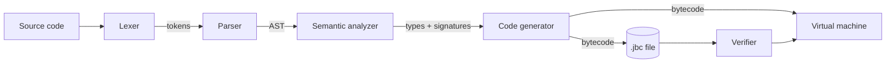

# Java-Safe C++ Architecture

## Overview

`jscpp` is a self-contained compiler and virtual machine for a safe subset of C++.

## Compiler stages

1. **Lexer** (`src/lexer`): a hand-written scanner. Produces tokens with file, line and column.
   Unsupported C++ keywords and characters are rejected here with a specific message.
2. **Parser** (`src/parser`): recursive descent with one function per precedence level. Builds an
   AST of `Expr` and `Stmt` nodes. `for` loops, `++`/`--` and compound assignments are rewritten
   into simpler nodes so later stages handle fewer cases. `ASTPrinter` implements `jscpp ast`.
3. **Semantic analyzer** (`src/semantic`): an AST visitor with a scoped symbol table. Pass 1
   records every function signature; pass 2 type-checks each body, checks l-values, and checks
   that non-void functions always return. It stores the type of every expression and declaration
   for the code generator.
4. **Code generator** (`src/bytecode/CodeGenerator.cpp`): a second visitor that emits bytecode.
   It keeps its own scope stack to map variables to frame slots and to know which pointers and
   arrays must be released when a scope ends or a function returns. This is where the safety
   instructions are inserted.

All AST passes use the visitor pattern (`ASTVisitor` in `src/parser/AST.h`).

## Bytecode

`BytecodeProgram` (`src/bytecode/Bytecode.*`) holds the constant table, the function table and the
instructions. It can be dumped as text, saved to and loaded from a `.jbc` file, and verified.

## Virtual machine

`VM` (`src/vm`) is a fetch-decode-execute loop over the instruction array. It keeps:

- **Operand stack**: values for expression evaluation.
- **Call stack**: one `Frame` per call (return address, base of its locals, number of locals).
- **Locals**: one array shared by all frames; each frame owns a window of it.
- **Heap**: a map from handle to `ManagedObject` (reference count, size, cells).

Every value is a 32-bit `int`. Static typing guarantees an `int` is never used as a pointer.

## Error handling

Compile errors are C++ exceptions (`LexerError`, `ParserError`, `SemanticError`) carrying a
`SourceLocation`; `main.cpp` prints the location, the source line and a caret. Runtime errors are
`RuntimeError` subclasses; the VM catches them, prints the line and function from the
instruction's line table, and returns status 1.
